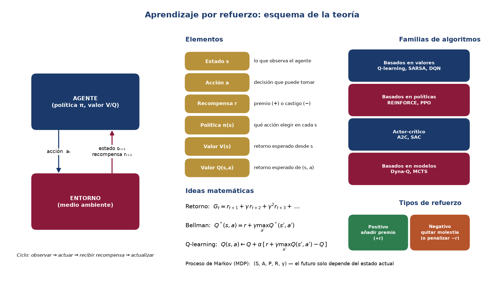

## Teoría paso a paso

### Paso 1. ¿Qué es el aprendizaje por refuerzo (RL)?
Es una forma de aprendizaje automático en la que un **agente** aprende a decidir **interactuando** con un entorno. No recibe ejemplos etiquetados (como en el aprendizaje supervisado) ni busca patrones sin guía (no supervisado): recibe **recompensas** y aprende, por ensayo y error, qué acciones le convienen. La meta es **maximizar la recompensa total acumulada**, no solo la inmediata.

### Paso 2. El ciclo agente–entorno
En cada instante *t*:
1. El agente **observa** el estado `sₜ`.
2. **Elige una acción** `aₜ`.
3. El entorno responde con una **recompensa** `rₜ₊₁` y un **nuevo estado** `sₜ₊₁`.
4. El agente **aprende** de esa experiencia `(s, a, r, s')` y repite.

### Paso 3. Los seis elementos básicos

| Elemento | Qué es | Ejemplo (coche que se estaciona) |
|---|---|---|
| **Medio ambiente** | Todo lo externo al agente con lo que interactúa | El estacionamiento |
| **Estado** `s` | Descripción de la situación actual | Posición, orientación, velocidad |
| **Acción** `a` | Lo que el agente puede hacer | Girar, acelerar, frenar |
| **Recompensa** `r` | Número que indica qué tan bueno fue lo ocurrido | +100 estacionado, −50 choque |
| **Política** `π(s)` | Regla que asigna una acción a cada estado | «Si estoy cerca del cajón, voy despacio» |
| **Valor** `V(s)`, `Q(s,a)` | Recompensa **futura** total esperada | Qué tan prometedora es una posición |

**Diferencia clave:** la recompensa es lo que pasa *ahora*; el valor es lo que se espera obtener *de aquí en adelante*. Una acción puede dar poca recompensa hoy y mucho valor mañana.

### Paso 4. El retorno y el factor de descuento γ
El agente no maximiza una sola recompensa sino el **retorno**:

`Gₜ = rₜ₊₁ + γ·rₜ₊₂ + γ²·rₜ₊₃ + …`   con `0 ≤ γ ≤ 1`

- `γ` cerca de 0 → agente **miope** (solo le importa lo inmediato).
- `γ` cerca de 1 → agente **previsor** (valora el largo plazo).
Con `γ = 0.9`, una recompensa dentro de 2 pasos vale `0.9² = 0.81` de su valor original.

### Paso 5. Procesos de decisión de Markov (MDP)
El RL se modela formalmente como un **MDP**: la tupla `(S, A, P, R, γ)`:
- `S`: conjunto de estados · `A`: conjunto de acciones.
- `P(s'|s,a)`: probabilidad de llegar a `s'` si hago `a` en `s`.
- `R(s,a)`: recompensa · `γ`: descuento.

**Propiedad de Markov:** el futuro depende **solo del estado actual**, no de cómo se llegó a él. Por eso basta con conocer `s` para decidir.

### Paso 6. Funciones de valor y ecuación de Bellman
- `V^π(s)`: retorno esperado empezando en `s` y siguiendo la política `π`.
- `Q^π(s,a)`: retorno esperado haciendo `a` en `s` y luego siguiendo `π`.

La **ecuación de Bellman** expresa el valor de forma recursiva: *valor = recompensa inmediata + valor descontado de lo que sigue*. Para la política óptima:

`Q*(s,a) = r + γ · max_{a'} Q*(s',a')`

Esta idea es el corazón de casi todos los algoritmos de RL.

### Paso 7. Q-learning: aprender Q con la experiencia
Cuando no conocemos el entorno, estimamos `Q` con cada experiencia `(s, a, r, s')`:

`Q(s,a) ← Q(s,a) + α · [ r + γ · max_{a'} Q(s',a') − Q(s,a) ]`

- `α` (tasa de aprendizaje): cuánto se deja corregir por la nueva información.
- `r + γ·max Q(s',·)`: el **objetivo** (lo que ahora creemos que vale esa acción).
- `[objetivo − Q(s,a)]`: el **error TD**; si es 0, la estimación ya es consistente.

**Cómo aplicarlo a mano (receta):**
1. Identifica `s`, `a`, `r`, `s'`.
2. Busca `Q(s,a)` actual en la tabla.
3. Busca `max Q(s',·)` (el mejor valor en el estado siguiente).
4. Calcula el objetivo `r + γ·max Q(s',·)`.
5. Calcula el error TD = objetivo − `Q(s,a)`.
6. Actualiza `Q(s,a) = Q(s,a) + α·error`.
7. Repite con la siguiente experiencia.

Q-learning es **off-policy**: aprende el valor de la política óptima aunque el agente explore con otra.

### Paso 8. Exploración vs. explotación (ε-greedy)
Si solo repite lo mejor conocido, nunca descubre algo mejor. Con **ε-greedy**: con probabilidad `ε` elige una acción al azar (**explora**) y con `1−ε` la de mayor `Q` (**explota**). Es habitual empezar con `ε` alto y reducirlo con el tiempo.

### Paso 9. Familias de algoritmos
| Familia | Idea | Ejemplos | Cuándo usarla |
|---|---|---|---|
| **Basados en valores** | Aprenden `Q` y actúan con `argmax` | Q-learning, SARSA, DQN | Acciones discretas |
| **Basados en políticas** | Optimizan `π` directamente | REINFORCE, PPO | Acciones continuas, políticas estocásticas |
| **Actor-crítico** | Combinan ambos | A2C, SAC | Problemas complejos, aprendizaje estable |
| **Basados en modelos** | Aprenden/usan un modelo del entorno para planificar | Dyna-Q, MCTS | Cuando interactuar es caro y se puede simular |

### Paso 10. Tipos de refuerzo: positivo y negativo
- **Refuerzo positivo:** se **añade** algo agradable tras la conducta para que aumente (ej.: +20 por entregar el paquete).
- **Refuerzo negativo:** se **retira** algo desagradable tras la conducta para que aumente (ej.: al volver a la estación desaparece la «alarma» de batería baja).
- **Castigo / penalización:** se añade algo desagradable (o se quita algo bueno) para que la conducta **disminuya** (ej.: −10 por chocar). Aunque en la práctica se escriben como recompensas negativas, conceptualmente **no es lo mismo** que el refuerzo negativo.

En RL ambos tipos de señal son simplemente valores `r` positivos o negativos que moldean la política.
